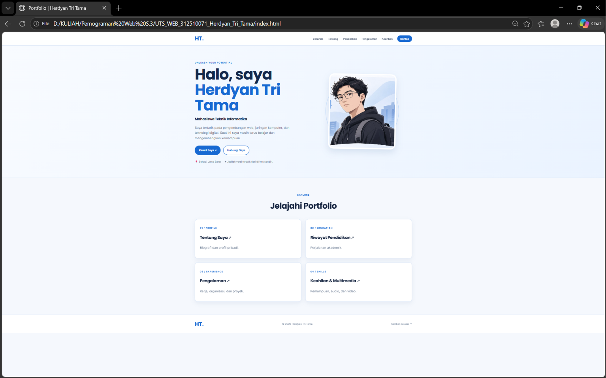
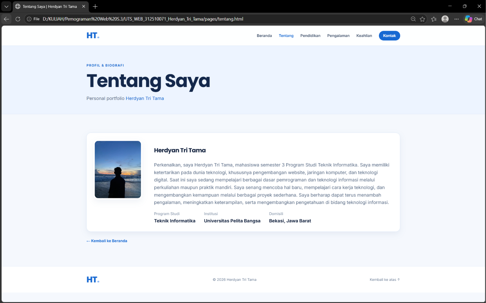
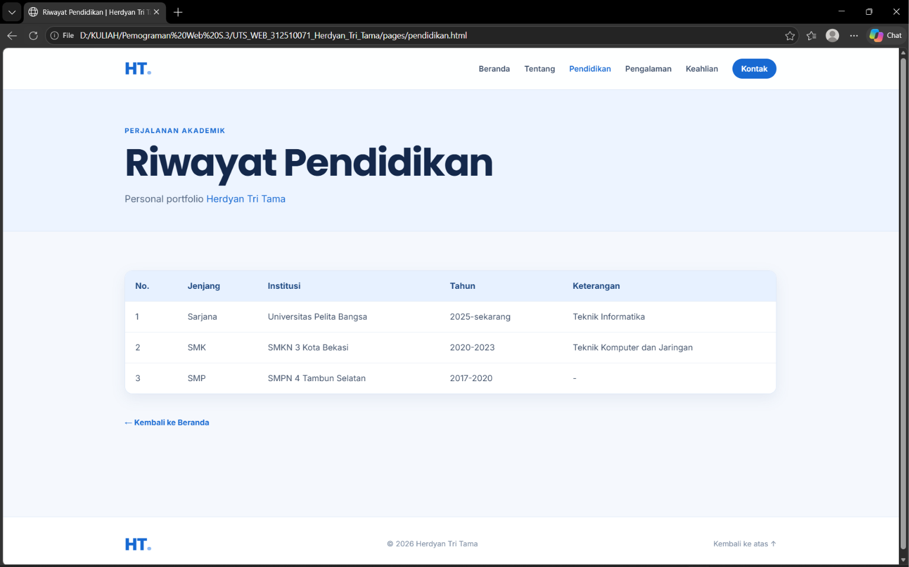
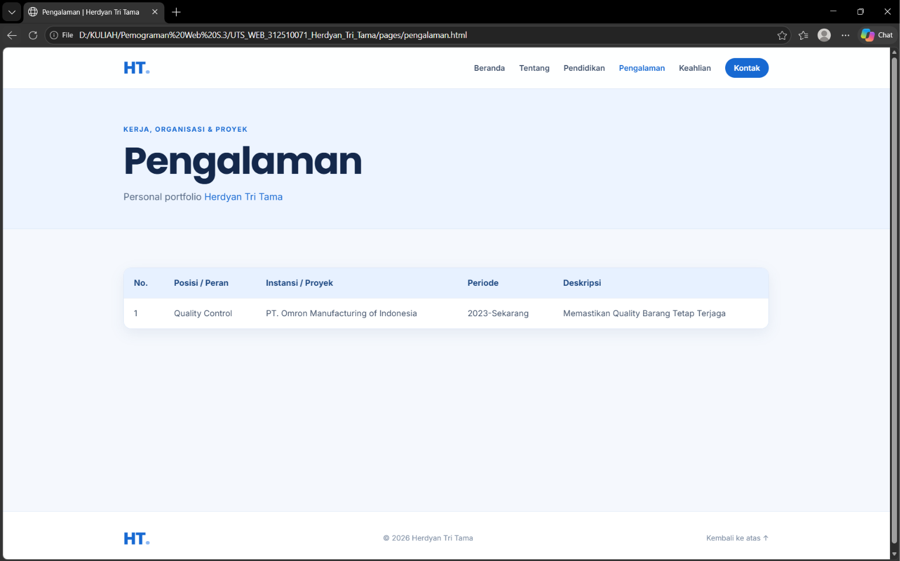
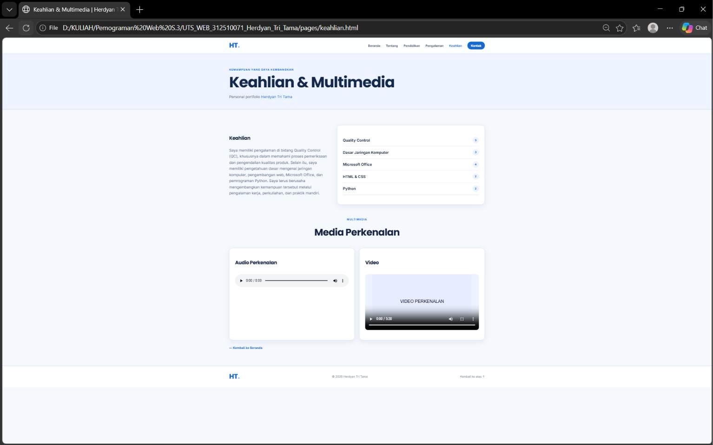
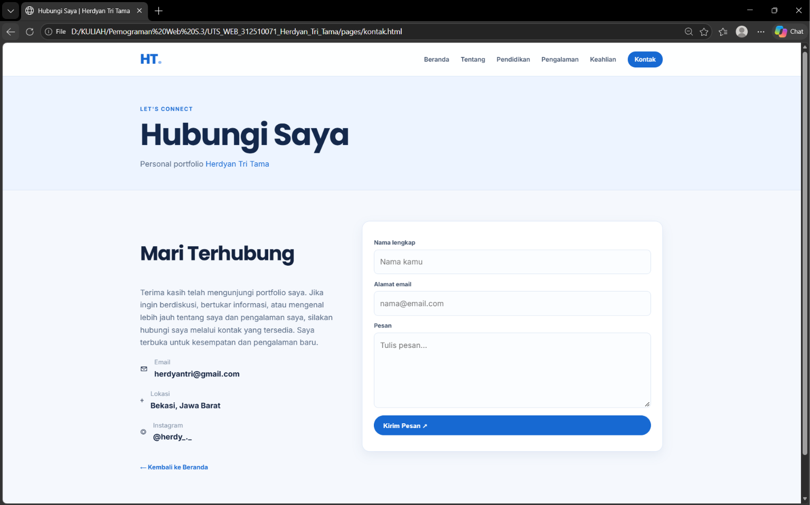

# README — Personal Portfolio Website

**Nama:** Herdyan Tri Tama  
**NIM:** 312510071  

## 1. Ringkasan Proyek

Website ini merupakan personal portfolio yang dibuat menggunakan **HTML dan CSS** . Website menampilkan profil singkat, riwayat pendidikan, pengalaman kerja, keahlian, media perkenalan, serta informasi kontak.

Desain menggunakan nuansa biru dan putih dengan tata letak responsif agar dapat diakses melalui laptop maupun perangkat mobile.

## 2. Proses Pembuatan

1. **Menyiapkan struktur proyek**  
   Membuat folder utama, folder `pages` untuk halaman tambahan, `images` untuk aset gambar, dan `media` untuk audio/video.
2. **Membangun halaman beranda (`index.html`)**  
   Menambahkan navigasi utama, bagian perkenalan, foto profil, tombol menuju halaman Tentang dan Kontak, serta kartu pintasan portfolio.
3. **Membuat halaman informasi**  
   Membuat halaman Tentang, Pendidikan, dan Pengalaman untuk menyajikan profil serta informasi akademik dan pengalaman kerja.
4. **Membuat halaman Keahlian & Multimedia**  
   Menampilkan daftar kemampuan dan menyediakan pemutar audio serta video perkenalan.
5. **Membuat halaman Kontak**  
   Menampilkan informasi kontak dan formulir yang meminta nama, email, serta pesan.
6. **Mengatur tampilan dan interaksi**  
   Menggunakan `style.css` untuk warna, tipografi, layout, dan responsivitas. Menu navigasi mobile dibuat dengan teknik checkbox + label (CSS saja), dan validasi formulir memakai atribut bawaan HTML5.
7. **Melakukan pemeriksaan tampilan**  
   Meninjau setiap halaman dan membuat dokumentasi tangkapan tampilan dari file proyek. Gambar pada folder `screenshots` merupakan hasil render halaman proyek ini, bukan screenshot yang dikirim oleh pengguna.

## 3. Dokumentasi Tampilan Step by Step

### Step 1 — Halaman Beranda
Halaman awal berisi identitas, deskripsi singkat, foto profil, dan tombol navigasi menuju bagian portfolio.

### Step 2 — Halaman Tentang
Halaman ini berisi informasi dan pengenalan diri pemilik portfolio.

### Step 3 — Riwayat Pendidikan
Menampilkan riwayat pendidikan dalam bentuk tabel agar informasi jenjang, institusi, dan tahun lebih mudah dibaca.

### Step 4 — Pengalaman
Menampilkan pengalaman kerja beserta posisi, instansi, periode, dan deskripsi singkat.

### Step 5 — Keahlian & Multimedia
Menampilkan daftar keahlian serta komponen audio dan video sebagai media perkenalan.

### Step 6 — Halaman Kontak
Menampilkan informasi untuk menghubungi pemilik portfolio dan formulir pesan dengan validasi input.

